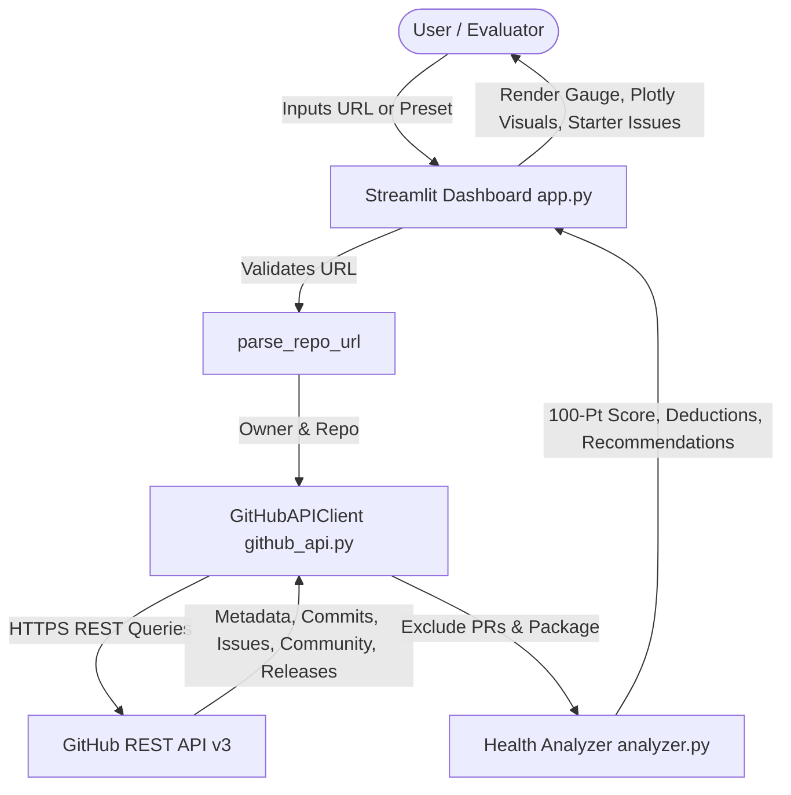

# 🧭 GitHub Repository Health & Beginner Contribution Assistant

[](https://www.python.org/)
[](https://streamlit.io/)
[](https://opensource.org/licenses/MIT)
[](https://pytest.org/)

An explainable, real-time repository health evaluator and beginner contribution gateway designed for college project presentations, student developers, and open-source newcomers.

---

## 🎯 1. Project Overview & Objective

Open-source repositories vary dramatically in activity, maintainer responsiveness, and beginner-friendliness. Newcomers often struggle with:
- Submitting pull requests to abandoned or unmaintained projects.
- Navigating confusing repository structures without clear setup documentation.
- Finding genuinely approachable introductory issues.

This web application connects directly to the **live GitHub REST API v3** to perform real-time audits without mock data. It computes an explainable **100-point Health Score** across five distinct dimensions, identifies genuine starter issues, provides prioritized recommendations with evidence, and strictly filters out Pull Requests from issue calculations.

---

## 🏛️ 2. Architecture & Project Structure

The project maintains a clean, modular structure with zero unnecessary complexity:

```text
github-health-assistant/
│
├── app.py                  # Streamlit dashboard UI, interactive charts, and feedback form
├── github_api.py           # GitHub REST API client, URL parser, PR filter, and rate limiter
├── analyzer.py             # Rule-based 100-point scoring engine, deductions, and recommendations
├── requirements.txt        # Minimal production dependencies
├── feedback_store.json     # Local persistent storage for student/evaluator feedback
├── README.md               # Complete project documentation and competition guide
│
└── tests/
    ├── test_github_api.py  # Unit tests for URL validation, API mocks, and PR exclusion
    └── test_analyzer.py    # Unit tests for score boundaries, category weights, and deductions
```

### System Architecture Flow:



---

## 💯 3. Explainable 100-Point Scoring Methodology

The health evaluation is calculated across five categories, each backed by explicit rules and measurable thresholds:

| Category | Weight | Indicators Evaluated | Deduction Rules |
| :--- | :---: | :--- | :--- |
| **Documentation** | **25 pts** | README presence & size, OSI license, Contributing guide, Code of Conduct, Issue templates | -12 pts if no README; -5 pts if no License; -4 pts if no CONTRIBUTING; -2 pts if no Code of Conduct; -2 pts if no issue/PR templates |
| **Activity & Maintenance** | **25 pts** | Recency of last push, commit frequency in default branch, release cadence | -25 pts if Archived/Disabled; -3 to -10 pts based on push staleness (>30d, >90d, >180d, >365d); -2 to -7 pts if no recent tagged releases |
| **Issue Management** | **20 pts** | Issue resolution ratio, categorization labeling hygiene, median age of open issues (*strictly excludes PRs*) | -8 pts if low closure rate (<10%); -6 pts if issues lack labels; -4 pts if median issue age > 180 days; -20 pts if Issues are disabled |
| **Community Participation** | **15 pts** | Contributor pool diversity, fork count, star engagement | -4 to -6 pts if bus factor = 1 (single contributor); -3 to -4 pts if forks < 5; -3 to -4 pts if stars < 10 |
| **Beginner Accessibility** | **15 pts** | Flagged starter issues (`good first issue`, `help wanted`), onboarding guides | -8 pts if 0 beginner issues; -4 pts if no CONTRIBUTING onboarding guide; -3 pts if no open issues available |
| **Total** | **100 pts** | | Sum of all five categories (capped between 0 and 100) |

### Qualitative Health Ratings:
- **85 – 100**: 🟢 **Excellent** (Well-documented, active, highly accessible)
- **70 – 84**: 🔵 **Good** (Healthy project with minor documentation or triage gaps)
- **50 – 69**: 🟡 **Moderate** (Maintained, but higher barrier for newcomers)
- **30 – 49**: 🟠 **Needs Attention** (Stale commits, unaddressed issues, or missing guides)
- **0 – 29**: 🔴 **Dormant / Critical** (Archived, inactive > 1 year, or minimal content)

---

## 🛡️ 4. GitHub API Reliability & Limitations Policy

1. **Strict Pull Request Exclusion:**
   GitHub’s `/repos/{owner}/{repo}/issues` REST API endpoint returns both issues and pull requests by default. Our `github_api.py` checks for the absence of the `'pull_request'` key on every item, ensuring metrics accurately reflect pure issues.
2. **Rate Limit Transparency:**
   Unauthenticated queries are subject to GitHub's 60 requests/hour IP limit. The sidebar displays real-time remaining requests and reset timestamps. Users can optionally provide a Personal Access Token (`GITHUB_TOKEN`) to unlock 5,000 requests/hour.
3. **API Pagination Awareness:**
   Commit and issue analyses evaluate up to 100 recent items per sample to balance deep audit capabilities with request quotas. Contributor counts read the `Link` header to estimate repository-wide contributor totals.
4. **Honest Documentation Claims:**
   We evaluate file existence and byte size. We do not claim to assess prose eloquence or grammatical quality without full text processing.
5. **Stars vs. Quality:**
   Star count is treated as a metric of community awareness and popularity, never as proof of bug-free code or architectural security.

---

## 💻 5. Installation & Execution Guide

### Prerequisites
- Python 3.10+ (tested on Python 3.14 on Windows)
- Git (optional)

### Setup via Windows PowerShell

```powershell
# 1. Clone or navigate to the project directory
cd c:\Users\najwa\Downloads\github-health-assistant

# 2. Create a virtual environment
python -m venv .venv

# 3. Activate the virtual environment
.\.venv\Scripts\Activate.ps1

# 4. Install dependencies
pip install -r requirements.txt

# 5. Run automated unit tests
python -m pytest tests/ -v

# 6. Launch the Streamlit application
streamlit run app.py
```

*The application will automatically launch in your browser at `http://localhost:8501`.*

---

## 🧪 6. Automated Testing Suite

The project includes unit tests covering URL normalization, API mocking, rate limiting, and score boundary conditions:

```powershell
python -m pytest tests/ -v
```

### Test Coverage Highlights:
- **`tests/test_github_api.py`**:
  - Validates various URL formats: `https://github.com/owner/repo`, `owner/repo`, `.git` suffixes, subpaths, and ssh urls.
  - Rejects invalid inputs (consecutive slashes, malformed domains, missing components).
  - Verifies HTTP 404, 401, and 403 (Rate Limit) exception handling.
  - Asserts that pull requests are strictly excluded from issue counts.
  - Verifies beginner issue label filtering.
- **`tests/test_analyzer.py`**:
  - Validates category weights sum to 100.
  - Verifies score boundaries (0 to 100).
  - Asserts archived repositories are penalized in activity.
  - Asserts deduction reasons, evidence strings, and actionable recommendations.

---

## 🎤 7. Competition Demonstration Walkthrough

When presenting this project to evaluators:

1. **Step 1: Introduction (1 minute)**
   - Highlight the problem: Beginners often abandon open source after contributing to inactive repositories or getting stuck on hard tasks.
   - Point out that this tool evaluates true repository health and surfaces curated starter issues using the live GitHub REST API.

2. **Step 2: Live Analysis Demo (2 minutes)**
   - Select the preset `pallets/flask` or `psf/requests` from the sidebar dropdown.
   - Click **Analyze Repository**.
   - Show the dynamic status spinner indicating real-time API calls to GitHub.
   - Reveal the **Overall Health Score** (e.g. 79/100) and color-coded badge.

3. **Step 3: Deep Dive into Explainability (2 minutes)**
   - Point out the **Pure Issues vs PR Excluded** metric card: explain that GitHub conflates PRs and issues in its API, and our system actively separates them.
   - Open the **Activity & Charts** tab: show the interactive Plotly commit histogram and issue resolution pie chart.
   - Open the **Beginner Issues** tab: highlight issues labeled `good first issue` with clickable links, author tags, and age. Emphasize the disclaimer: *labels reflect intent, not guaranteed simplicity*.
   - Open the **Recommendations** tab: show that each suggestion is prioritized (Critical/High/Medium) and directly backed by evidence from the audit.

4. **Step 4: Transparency & Feedback (1 minute)**
   - Open **Methodology & Formula**: review the 5 categories and point weights.
   - Open **Student Feedback**: demonstrate the interactive feedback form and show how entries persist in `feedback_store.json`.

---

## 🚀 8. Future Roadmap

- [ ] **AI/ML Issue Complexity Classifier**: Train a lightweight NLP model (TF-IDF + Scikit-Learn or fine-tuned Transformer) on issue titles and descriptions to score reading grade level and technical difficulty.
- [ ] **Automated PR Template Generator**: Allow maintainers to click a button to download starter `.github/ISSUE_TEMPLATE` and `CONTRIBUTING.md` files based on missing audit items.
- [ ] **Repository Comparison Mode**: Side-by-side comparison of two competing repositories within the same ecosystem.
- [ ] **Webhook Support**: GitHub Action integration to run health audits on every release.
